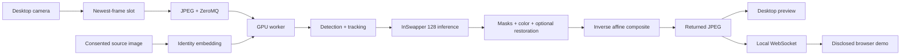

<div align="center">

# Interview Face Swap

### Consent-based single-image face transfer with remote GPU inference

[](#technology)
[](docs/MODELS.md)
[](docs/VALIDATION.md)

This research integration documents real-time face processing, frame transport, tracking, masking, and compositing.

[Get started](docs/SETUP.md) · [Architecture](docs/ARCHITECTURE.md) · [Model details](docs/MODELS.md) · [Responsible use](docs/RESPONSIBLE_USE.md) · [Validation](docs/VALIDATION.md) · [Security](SECURITY.md)

</div>

## Start with the single-image workflow

The selected public workflow is **one consented source photograph → an InsightFace identity embedding → `inswapper_128` inference on live target frames**. The archived Deep-Live-Cam runtime prefers `inswapper_128_fp16.onnx` when available and falls back to its full-precision variant. The public server deliberately excludes personalized training videos and DFM weights.

This is the **better fit for this public project** because it needs only one explicitly supplied image, keeps identity data easier to audit, and avoids a private training dataset or personalized model. It is not a claim that it universally wins every visual-quality comparison.

> **Development status:** the client transport is tested with generated frames. The full CUDA/model pipeline requires compatible model weights and dependencies and has not been re-benchmarked for this public release. This research integration is not ready for use in interviews or identity verification.

## What the project does

- Captures camera frames on the desktop and keeps only the newest frame to reduce queue buildup.
- Encodes JPEG frames, sends them to a GPU worker with ZeroMQ, and receives processed images.
- Uses a reference identity, target-face detection, spatial tracking, optical flow and a One Euro filter to stabilize alignment.
- Combines a feathered box mask, occlusion mask and optional face-region mask before color transfer and inverse-warp compositing.
- Provides optional GFPGAN restoration and original-mouth preservation.
- Relays processed images to a local WebSocket endpoint and a **localhost-only, visibly labelled Chrome preview**.
- Offers a generated-frame loopback mode that tests transport without a webcam, GPU, source face or model download.

The historical project name refers to its original interview-system prototype. Public use is intended for disclosed, consent-based demonstrations, accessibility experimentation, and computer-vision research. Do not use it to impersonate a person, misrepresent identity, or bypass interview or identity checks.

## Safety boundary

The public snapshot intentionally removes the archived device spoofing, function cloaking, third-party-site injection, personalized identity model and automatic reference-photo discovery. The browser component only renders a labelled preview on localhost and never replaces a camera. See [Responsible use](docs/RESPONSIBLE_USE.md).

## Test the transport locally

Python 3.10+ and the client dependencies are sufficient. Python 3.12 was used for the public smoke test.

```bash
git clone https://github.com/awanafnan17/interview-face-swap.git
cd interview-face-swap
python3 -m venv .venv
source .venv/bin/activate
python -m pip install -r requirements-client.txt
python single_image_model/client_core.py --synthetic --loopback --headless --test-frames 30 --width 320 --height 240 --benchmark
```

Windows PowerShell: use `py -3 -m venv .venv`, then `.venv\Scripts\Activate.ps1`; run the same `python` commands. Windows camera behavior remains unverified.

This test sends generated images through a local echo server. **It does not perform face swapping.** See [the full setup guide](docs/SETUP.md) for remote GPU execution and the browser demonstration.

## Pipeline



## Technology

| Layer | Actual implementation |
|---|---|
| Desktop client | Python, OpenCV, NumPy, threading/asyncio, PyZMQ, WebSockets |
| Inference | InsightFace, InSwapper 128/FP16, ONNX Runtime CUDA, PyTorch CUDA warm-up |
| Detection/identity | `buffalo_l` FaceAnalysis; recognition and 106-point landmark modules; FaceFusion detector fallback |
| Masking/restoration | FaceFusion XSeg, optional BiSeNet region parsing, optional GFPGAN 1.4 |
| Stabilization | Spatial continuity, pyramidal Lucas–Kanade optical flow, rigid-pose One Euro filtering |
| Browser research | Chrome Manifest V3 service worker and an always-disclosed localhost preview panel |

**Model accuracy matters:** older server comments/logs mentioned HyperSwap and a 512-pixel pipeline. The included loader actually instantiates **InSwapper 128**. A 256-pixel composition crop or 512-pixel restoration stage does not turn it into native 256/512 inference. [Read the exact model audit](docs/MODELS.md).

## Repository map

```text
single_image_model/       Desktop client and GPU integration server
chrome_extension/         Local-only browser research adapter and harness
vendor/Deep-Live-Cam/      Archived compatible runtime source and GPL notice
vendor/official_facefusion/ Archived 3.9.1 source and OpenRAIL-AS notice
docs/                     Setup, architecture, models, limitations and validation
requirements-client.txt   Lightweight transport environment
requirements-server.txt   GPU integration starting point
```

The original training recording, face photos, personalized model, runtime weights, cloud state and complete development chat exports are excluded. No database is needed for the demonstrated client/server flow.

## What is verified

- Python syntax across the public snapshot.
- JavaScript syntax and tests that enforce local-only origins, packet parsing and the absence of camera-identity or API-concealment hooks.
- A 30-frame generated-image client loopback with 30 responses.
- Redacted secret scanning and a source-only publication review.

These checks do not establish GPU throughput, end-to-end camera latency, visual identity quality or Windows hardware support. The browser component is a preview only and is intentionally not a meeting-platform or virtual-camera integration. [Validation details](docs/VALIDATION.md) explain the boundary.

## Credits and licensing

Integration and portfolio documentation by **Afnan Mehmood Awan**. The project builds on [Deep-Live-Cam](https://github.com/hacksider/Deep-Live-Cam), [InsightFace](https://github.com/deepinsight/insightface), [FaceFusion](https://github.com/facefusion/facefusion), [GFPGAN](https://github.com/TencentARC/GFPGAN) and research concepts from [DeepFaceLive](https://github.com/iperov/DeepFaceLive).

This is not a claim to have authored those underlying models. The root GPLv3 license covers the Deep-Live-Cam-derived portions; FaceFusion and third-party model assets retain their separate terms. Read [THIRD_PARTY_NOTICES.md](THIRD_PARTY_NOTICES.md) before redistribution or obtaining weights.
